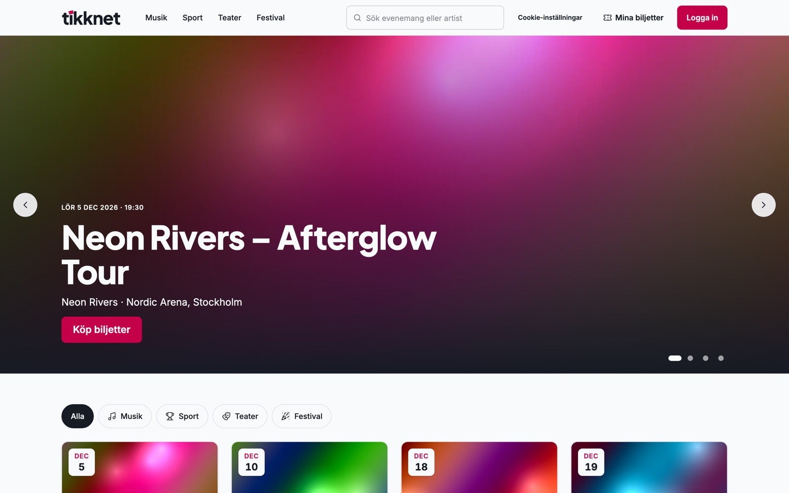
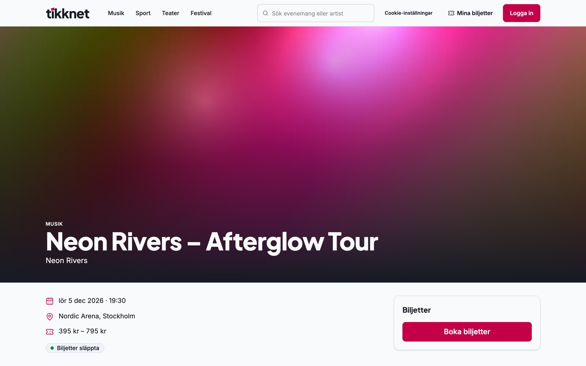
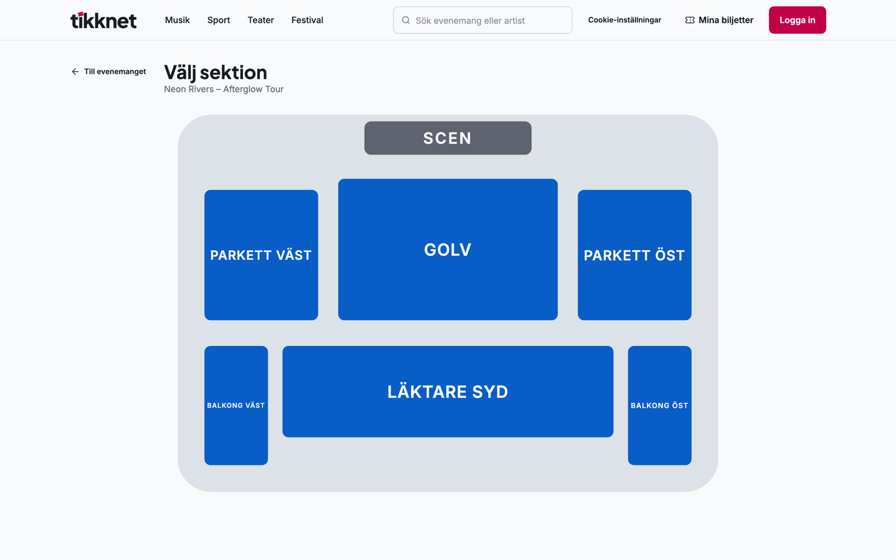
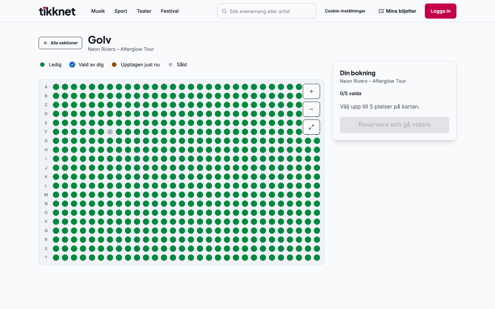
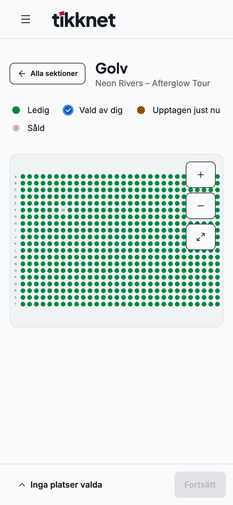
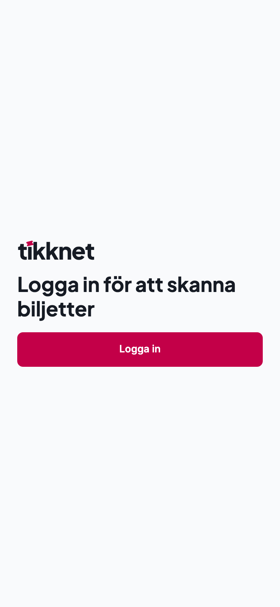
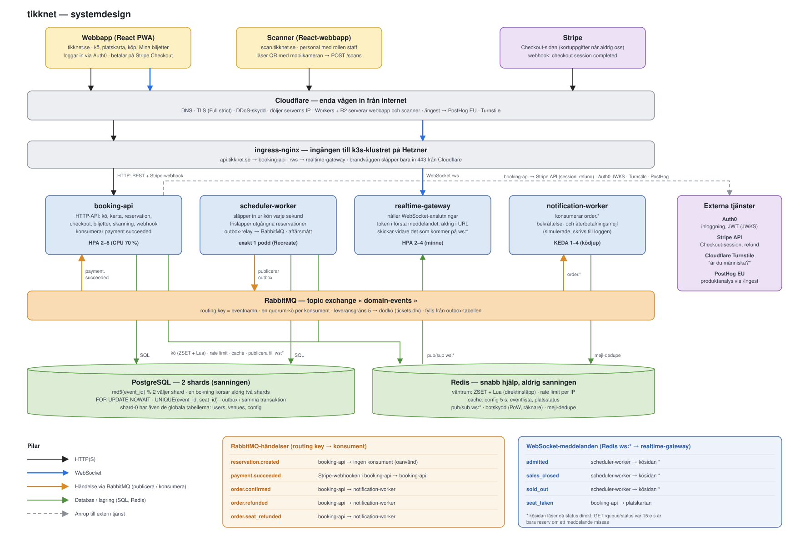
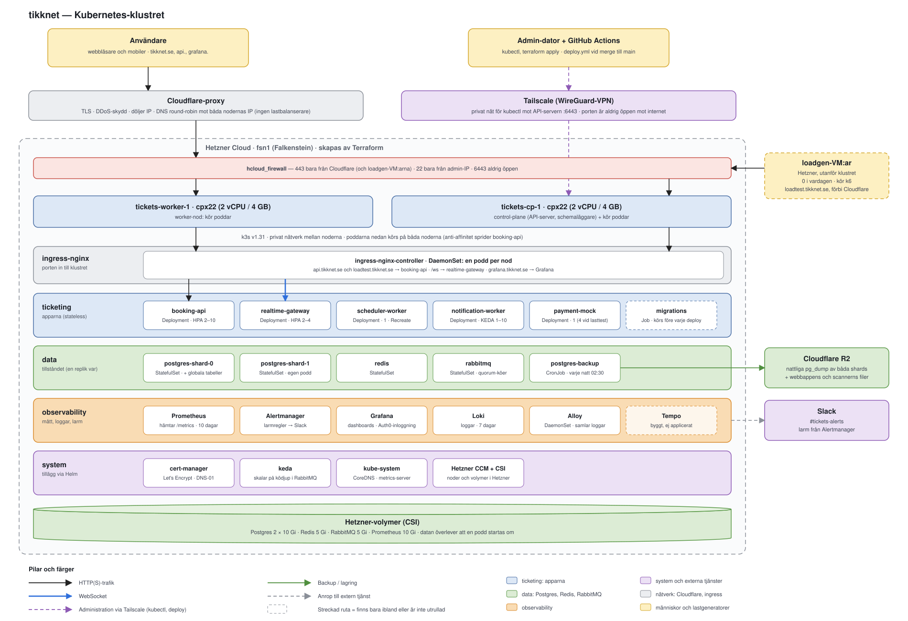
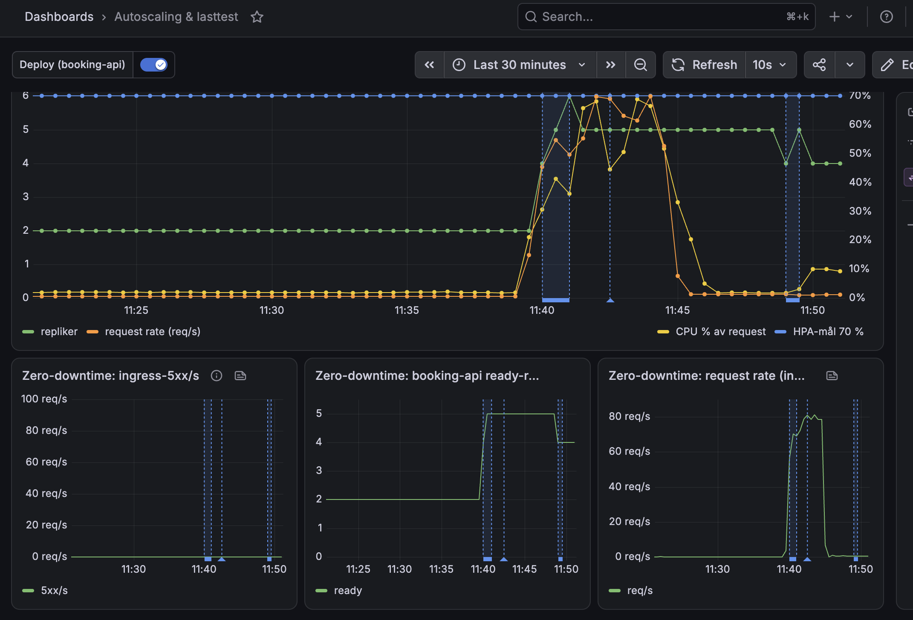

# tikknet

**A ticketing platform built for the worst fifteen minutes of a concert sale.**

Picture 5,000 seats going on sale at 10:00 and 50,000 booking attempts arriving in the next fifteen
minutes. Most ticket sites either fall over or sell the same seat twice. tikknet is my answer to that
problem: buyers queue in a waiting room, pick their seats on a live venue map, hold them for five
minutes, pay with Stripe and get a QR ticket on their phone. At the door, staff scan the tickets with
a separate scanner app.

I built it alone, from an empty repo to a running production system. That covers the frontend, the backend services, the database design, the infrastructure,
the CI/CD pipeline and the monitoring. It runs today on a two-node Kubernetes cluster on Hetzner
Cloud behind Cloudflare.

**In short:**

- **No seat is ever sold twice.** That is guaranteed by the database itself, and the load tests confirmed it.
- **Traffic spikes become a queue, not errors.** A waiting room lets buyers in at a steady rate.
- **Deploys with zero downtime.** 0 failed requests out of 22,978 while rolling the API under load.
- **Pods scale themselves** on CPU and on message queue depth.
- **Stack:** TypeScript end to end, React + Vite, Fastify, Postgres, Redis, RabbitMQ, Kubernetes
  (k3s), Terraform, Cloudflare, Prometheus + Grafana + Loki, k6 and Playwright.

|                  | Live                                                     |
| ---------------- | -------------------------------------------------------- |
| Web app          | [tikknet.se](https://tikknet.se)                         |
| API              | [api.tikknet.se](https://api.tikknet.se)                 |
| Ticket scanner   | [scan.tikknet.se](https://scan.tikknet.se) (staff login) |
| Grafana          | [grafana.tikknet.se](https://grafana.tikknet.se) (login) |
| Images and brand | [cdn.tikknet.se](https://cdn.tikknet.se)                 |

### Try it yourself

1. Book a ticket on [tikknet.se](https://tikknet.se). Payments run in Stripe test mode, so use the
   card `4242 4242 4242 4242` with any future expiry date and any CVC.
2. Open the QR code under "Mina biljetter".
3. Log in to the scanner at [scan.tikknet.se](https://scan.tikknet.se) on another device and scan it:

   |          |                      |
   | -------- | -------------------- |
   | Email    | `staff-demo@test.se` |
   | Password | `tikknet123`         |

Scan the same ticket a second time and the scanner says it has already been used.

---

## Contents

1. [Screenshots](#screenshots)
2. [The case](#the-case)
3. [Why it is built this way](#why-it-is-built-this-way)
4. [Architecture](#architecture)
5. [Proof](#proof)
6. [Run it locally](#run-it-locally)
7. [Tests](#tests)
8. [Operations](#operations)
9. [What I would do next](#what-i-would-do-next)
10. [Repository layout](#repository-layout)

---

## Screenshots

**Start page and event page**

<p>
  
  
</p>

**Choosing seats.** First pick a section of the venue, then the seats. Seats taken by someone else
change colour live while you look at them.

<p>
  
  
</p>

**On a phone, and the scanner for door staff**

<p>
  
  &nbsp;&nbsp;
  
</p>

The web app is an installable PWA. Tickets are cached, so the QR code still opens in a basement
venue with no signal. The scanner is its own small app and marks each ticket as used exactly once.

---

## The case

The assignment was a ticketing system for a concert venue. These were the requirements I designed around:

| Requirement                          | What it means in practice                                               |
| ------------------------------------ | ----------------------------------------------------------------------- |
| 5,000 seats, 15-minute sale window   | Almost all traffic arrives at once, then nothing                        |
| Up to 50,000 booking attempts        | Ten times more people than seats, so most of them must get a clean "no" |
| Never sell a seat twice              | Correctness under concurrency matters more than raw speed               |
| Hold seats while the buyer pays      | Reservations that expire on their own after five minutes                |
| Survive deploys and crashes mid-sale | Zero-downtime rollouts and no lost payment events                       |

The whole plan (in Swedish) is in [docs/plan.md](docs/plan.md).

---

## Why it is built this way

Every larger decision comes back to one of the requirements above.

**A waiting room in front of the booking flow.** 50,000 people hitting "book" at the same second
would burn the CPU on two small servers. Instead each buyer gets a signed queue token and a place in
a Redis queue, and the scheduler lets people in at a fixed rate. The page learns that you have been
let in over a WebSocket, and falls back to polling if the socket can't connect. When the queue is
empty, you walk straight in.

**Postgres decides, nothing else.** A seat is reserved in a single transaction that locks the rows
with `FOR UPDATE NOWAIT`, in sorted order so two buyers can never deadlock each other. On top of
that, a partial unique index on `tickets (event_id, seat_id)` makes a double sale impossible even if
the application code had a bug. Redis is only used for things that may be wrong for a second: the
queue, rate limiting and a two-second cache of the seat map.

**Two database shards, keyed by event.** All seats for one concert live on the same shard, so a
booking never needs a transaction across two databases. Another big event on the other shard does
not slow this one down.

**A transactional outbox for payments.** When Stripe says an order is paid, the status change and
the "send the tickets" message are written in the same transaction. A relay forwards the message to
RabbitMQ afterwards. If a pod dies in between, nothing is lost, and the worker that sends emails can
scale up on its own when the queue grows.

**The frontend is static files on Cloudflare.** The React app is built once and served from
Cloudflare R2 at the edge, so the servers only handle API calls. The seat map responses are short
lived and cached by Cloudflare too, which takes most of the read traffic off the cluster during a sale.

**Small, separate services.** The booking API, the WebSocket gateway, the scheduler, the notification
worker and a payment mock each scale on their own. Shared code (database access, auth, logging,
schemas) lives in workspace packages instead of being copied around.

**Boring infrastructure that I can explain.** k3s instead of a managed cluster kept the bill low and
let me learn what a cluster actually does. All of it is created with Terraform and deployed with
Kustomize, so the whole system can be rebuilt from the repo.

The full reasoning for each choice, including the alternatives I turned down, is in
[docs/forsvar.md](docs/forsvar.md) and the [decision records](docs/adr/).

---

## Architecture

**The whole system.** From the browser through Cloudflare to the services, the two Postgres shards,
Redis and RabbitMQ.



**The Kubernetes cluster.** What runs on which of the two nodes, and what scales.



More diagrams (the purchase flow, the request path, the deploy pipeline and the monitoring setup)
and the database tables are in [docs/architecture.md](docs/architecture.md) and
[docs/cluster.md](docs/cluster.md).

---

## Proof

### Zero-downtime deploys

While k6 sent 10 booking attempts per second for five minutes, I restarted the booking API twice
with a rolling update. The result was **0 failed requests out of 22,978**, no 5xx errors at the
ingress, and 2,993 completed bookings out of 3,000 attempts (the other seven got a correct "seat
already taken"). Median response time was 11 ms, p95 139 ms.

This is the Grafana dashboard from that run. The HPA scales the API from 2 to 5 pods as CPU climbs,
and the 5xx panels stay flat at zero through both rollouts.



The full run, with timestamps and how to repeat it, is in
[docs/evidence/zero-downtime.md](docs/evidence/zero-downtime.md).

### Load tests

Two sales were simulated with k6, each with about 50,000 booking attempts. In `normal-sale` they
were spread evenly over 15 minutes, and in `spike-sale` they came in sharp bursts over six and a
half minutes.

| Scenario      | Purchases | Tickets sold | Double-sold seats |
| ------------- | --------- | ------------ | ----------------- |
| `normal-sale` | 539       | 2,695        | 0                 |
| `spike-sale`  | 483       | 2,415        | 0                 |

Not every seat sells inside the window, and that is on purpose. The waiting room lets people in at a
fixed rate and most attempts end in a clean 409 "seat already taken", which is the honest answer
when 50,000 people want 5,000 seats.

### Monitoring

Prometheus collects request rate, errors and latency from every service, Loki collects logs, and
Grafana shows both. Alerts (high error rate, a growing message queue, crash-looping pods, a database
that is down) go to Slack. To keep CPU for the actual sale, a service only logs errors and slow requests, not every
request.

### Backups

Both shards are dumped to Cloudflare R2 every night. In a restore drill the download and restore
took about three seconds plus a few minutes of manual steps. The RPO is up to 24 hours, which is
written down as a known trade-off in the [runbook](docs/runbook.md).

---

## Run it locally

```bash
pnpm install
docker compose up -d                         # 2× Postgres, Redis, RabbitMQ
cp .env.example .env && set -a && . ./.env && set +a   # services read plain environment variables
pnpm --filter @tickets/db migrate            # both shards
pnpm --filter @tickets/scheduler-worker seed-events-from-csv   # 20 demo events
pnpm dev                                     # all services, the web app and the scanner
```

Fill in the empty values in `.env` first (Auth0, Stripe test keys, the queue and QR secrets). The web
app runs on http://localhost:5173 and the scanner on http://localhost:5174; their `VITE_*` settings
go in `apps/web/.env.local` and `apps/scanner/.env.local`. To run a single service:
`pnpm --filter @tickets/booking-api dev`. Logging in needs an Auth0 tenant (see the
[runbook](docs/runbook.md)).

---

## Tests

```bash
pnpm lint && pnpm typecheck
pnpm test                   # unit tests
pnpm test:integration       # Testcontainers: real Postgres, Redis and RabbitMQ
pnpm test:contract          # Pact consumer and provider tests
pnpm --filter @tickets/system-tests test:system   # black-box flows against a running stack
pnpm --filter @tickets/e2e-tests test:e2e         # Playwright in a real browser
```

The tests I care most about check the promises directly:

- 100 parallel attempts on the same seat give exactly one winner.
- Overlapping seat selections never deadlock.
- Ten identical requests with the same idempotency key create one reservation.
- A payment event survives RabbitMQ being down.

Load tests live in [tests/load](tests/load) (k6).

---

## Operations

Everything runs on Hetzner Cloud, created with Terraform ([infra/terraform](infra/terraform)) and
deployed with Kustomize ([infra/k8s](infra/k8s)). A merge to `main` runs the tests, builds the
images, migrates both shards and rolls out the new version. Cloudflare sits in front with caching, a
firewall and bot protection.

Everyday procedures (restoring a backup, switching to load-test mode, seeding events, turning on
debug logging) are in the [runbook](docs/runbook.md).

---

## What I would do next

- **Upgrade k3s.** The cluster runs v1.31, which is out of support. I didn't want to risk an upgrade
  this close to the exam, so it's first on the list afterwards.
- **Smaller backup window.** Continuous WAL archiving would bring the RPO down from 24 hours to minutes.
- **A third node.** Two nodes are enough for the load tests, but losing one during a sale would hurt.
  Right now only the pods scale, not the nodes.

---

## Repository layout

```
apps/       web (PWA), scanner (staff app)
services/   booking-api, realtime-gateway, scheduler-worker, notification-worker, payment-mock
shared/     auth, db, domain, observability, rabbit, redis, schemas, analytics, types, ui-theme
infra/      terraform, k8s (Kustomize)
tests/      e2e (Playwright), system (black-box), load (k6)
docs/       plan, rules, architecture, ADRs, runbook, evidence, diagrams
```

The code rules (layering, naming, database and security) are in [docs/rules.md](docs/rules.md) and
are enforced by ESLint.
