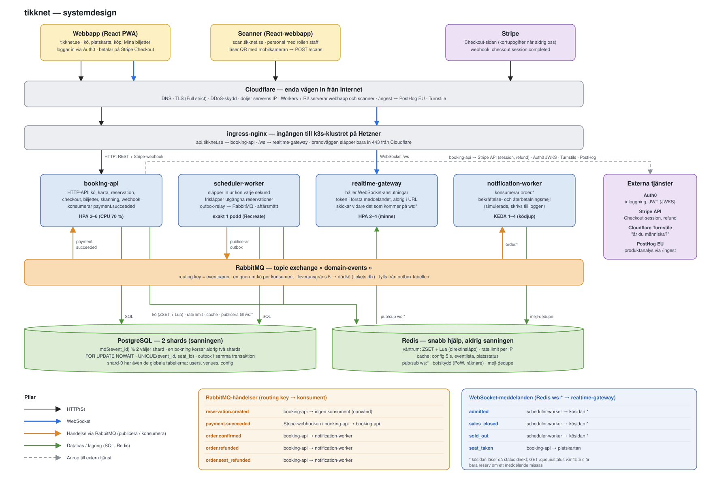
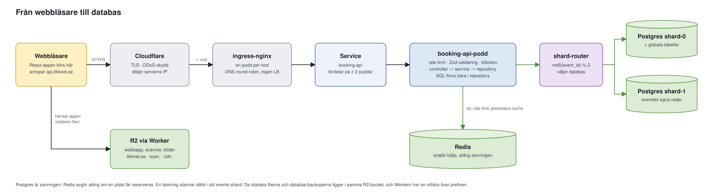
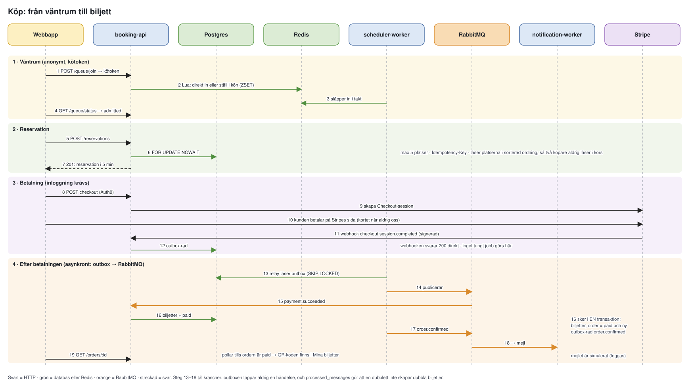
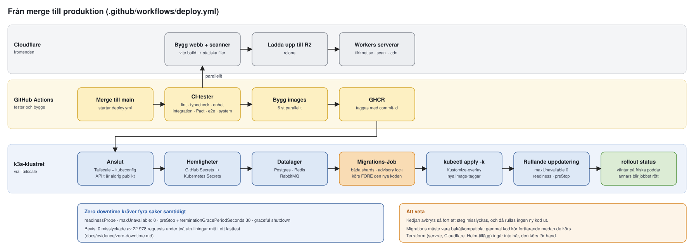
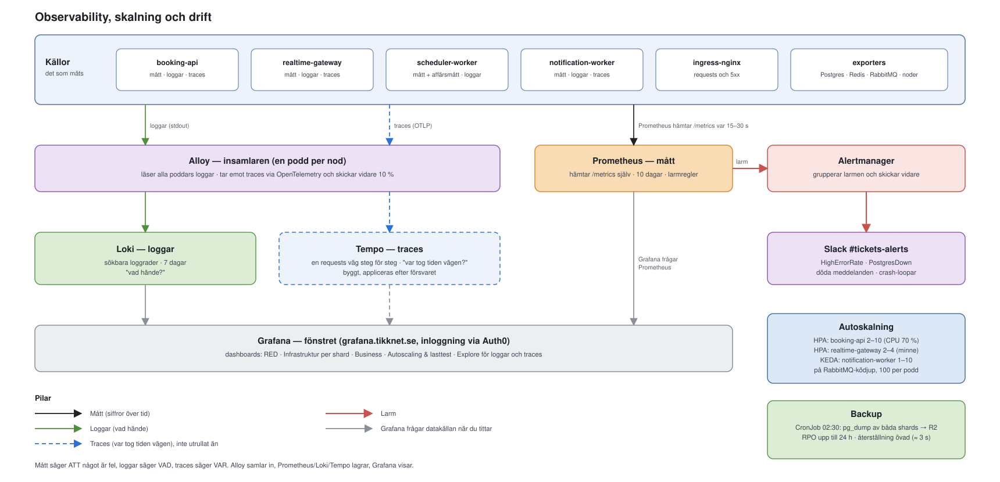

# Arkitektur

Översikt över hur systemet hänger ihop. Detaljerna och motiveringarna finns i
[plan.md](./plan.md), [forsvar.md](./forsvar.md) och ADR:erna i [adr/](./adr/). Diagrammen är
Mermaid-block som GitHub ritar upp. Klustret (noder, namnrymder, poddar) ritas separat i
[cluster.md](./cluster.md).

## Hela systemet

Lagren uppifrån och ned: klienter, Cloudflare, ingress-nginx, tjänsterna, RabbitMQ och sist datalagret.
Svart pil = HTTP(S), blå = WebSocket, orange = händelse via RabbitMQ, grön = databas/lagring, streckad
grå = anrop till extern tjänst. Postgres är sanningen, Redis är snabb hjälp som får gå förlorad. Källfilen
är [diagrams/system-design.svg](./diagrams/system-design.svg).

Händelserna och vem som tar emot dem:

| Event | Skrivs i outbox av | Konsumeras av |
|---|---|---|
| `reservation.created` | booking-api, vid reservation | ingen (publiceras, ingen kö binder den) |
| `payment.succeeded` | booking-api, i Stripe-webhooken | booking-api: biljetter, order `paid`, ev. återbetalning |
| `order.confirmed` | booking-api, när biljetterna skapats | notification-worker: bekräftelsemejl |
| `order.refunded` | booking-api, vid hel återbetalning | notification-worker: återbetalningsmejl |
| `order.seat_refunded` | booking-api, vid återbetalning av enstaka platser | notification-worker |

Varje kö har leveransgräns 5 och en dödkö `<kö>.dead` via `tickets.dlx`. WebSocket-meddelandena
(`admitted`, `sales_closed`, `sold_out`, `seat_taken`) är fire-and-forget: allt kan också läsas via
HTTP. Kösidan får insläppet över WebSocket och läser då status direkt; `GET /queue/status` var 15:e
sekund är bara reserv. Platskartan lyssnar på `seat_taken`.

## Från webbläsare till databas

En request går genom Cloudflare, direkt till en nods ingress-nginx (DNS round-robin mellan
noderna, ingen extern lastbalanserare, [ADR-0007](./adr/0007-dns-round-robin-without-lb.md)) och
vidare till en `booking-api`-podd. ingress-nginx och Servicen lastbalanserar över minst två poddar. Routinglagret hashar `event_id` och väljer shard
([ADR-0008](./adr/0008-sharding-per-event.md)). Postgres är sanningen: Redis avgör aldrig om en stol
får reserveras.

Statiska filer (webbappen, scannern, eventbilder, loggor) ligger i en R2-bucket och serveras av
Cloudflare Workers med en vitlista över prefixen, eftersom samma bucket även håller databas-backuperna.

## Databasen

Två Postgres-instanser (shard-0 och shard-1), var och en i en egen podd med egen volym. Ett event och
allt som hör till det ligger i samma shard (`md5(event_id) % 2`, [ADR-0008](./adr/0008-sharding-per-event.md)),
så en bokning korsar aldrig två databaser. Tabeller som inte hör till ett event ligger bara i shard-0.
Schemat skapas av migrationerna i `shared/db/migrations/` (`global/` och `sharded/`).

### Globala tabeller (bara shard-0)

| Tabell | Kolumner | Nyckel och regler | Skrivs av |
|---|---|---|---|
| `users` | id, auth0_sub, email, name, created_at | PK id. En rad per Auth0-användare | booking-api (vid checkout) |
| `venues` | id, name, city, stage_x/y/width/height | PK id. Arenan och scenens placering | seed-skript |
| `venue_sections` | id, venue_id, name, display_order, layout_x/y/width/height/rotation | PK id. Sektionerna på kartan | seed-skript |
| `venue_seats` | id, venue_id, section_id, row, number, x, y | PK id. Stolarnas geometri (ändras aldrig) | seed-skript |
| `config` | key, value | PK key. Ändringsbara inställningar: kötakt, hålltid, max stolar, botskydd | migrationer, eller för hand med SQL |

### Tabeller per event (i båda shards)

| Tabell | Kolumner | Nyckel och regler | Skrivs av |
|---|---|---|---|
| `events` | id, venue_id, title, artist, category, starts_at, sales_open_at, sales_close_at, status, image_url, description, featured | PK id. Shard-nyckeln är eventets eget id | seed-skript |
| `seats` | id, event_id, venue_seat_id, section_id, row, number, ticket_number, price_cents, status, reservation_id, updated_at | PK id. UNIQUE (event_id, section_id, row, number). status: available / held / sold | booking-api (låser och säljer), scheduler-worker (släpper utgångna) |
| `reservations` | id, event_id, queue_token_id, status, expires_at, release_after, payment_frozen_until, created_at | PK id. UNIQUE (queue_token_id) där status är active eller pending_payment: en pågående bokning per kötoken | booking-api (skapar, avbryter), scheduler-worker (låter gå ut, rensar gamla) |
| `idempotency_keys` | event_id, scope, key, request_hash, status, response_body, expires_at, created_at | PK (event_id, scope, key). Samma nyckel ger samma svar | booking-api |
| `orders` | id, event_id, user_id, reservation_id, total_cents, status, created_at | PK id. id räknas fram ur reservationens id | booking-api |
| `payments` | id, event_id, order_id, provider, provider_ref, provider_charge_ref, idempotency_key, amount_cents, status, raw_response, created_at | PK id. provider_ref = Stripe-sessionen | booking-api |
| `tickets` | id, event_id, order_id, seat_id, qr_token, status, scanned_at, scanned_by, created_at | PK id. **UNIQUE (event_id, seat_id) där status = valid: en plats kan aldrig ha två giltiga biljetter** | booking-api (konsumenten av `payment.succeeded`) |
| `ticket_scans` | id, event_id, ticket_id, gate, scanned_by, scanned_at | PK id. UNIQUE (event_id, ticket_id): en biljett släpper bara in en gång | booking-api (`POST /scans`) |
| `outbox` | id, event_id, type, payload, created_at, published_at | PK id. Händelser som väntar på RabbitMQ | booking-api (skriver), scheduler-worker (markerar publicerad) |
| `processed_messages` | event_id, message_id, consumer, processed_at | PK (event_id, message_id, consumer). Samma meddelande behandlas bara en gång | booking-api (konsumenten) |
| `waitlist` | id, event_id, contact, created_at | PK id. Förberedd för väntelista vid slutsålt, används inte | ingen |

`event_id` finns i varje tabell per event, och varje fråga filtrerar på den. Så hittar routern rätt shard,
och så stannar en bokning inom en databas.

### Vem skriver vad

Vi har **en gemensam databas**, inte en databas per tjänst. Två tjänster skriver till samma tabeller, och
det är ordnat så här:

- **booking-api** äger nästan allt: reservationer, order, betalningar, biljetter, skanningar och outboxen.
- **scheduler-worker** skriver bara det som är tidsstyrt: den släpper utgångna reservationer och deras
  stolar, rensar gamla reservationer och markerar outbox-rader som publicerade.
- **notification-worker** och **realtime-gateway** skriver aldrig till databasen. De använder bara Redis.
- **Seed- och underhållsskript** (scheduler-workerns `scripts/`) körs för hand och skapar event, arenor och
  stolar.

När två tjänster skriver till samma rad skyddar databasen sig själv: radlås (`FOR UPDATE NOWAIT` i
booking-api, `SKIP LOCKED` i scheduler-worker), samma låsordning överallt och unika index som sista spärr.
Priset jämfört med en databas per tjänst är att tjänsterna delar schema och måste ändras i takt
(migrationerna är därför alltid bakåtkompatibla).

## Köp: från väntrum till biljett

Kön och reservationen är anonyma (kötoken); inloggning krävs först vid betalning. Efter betalningen går
allt asynkront via transaktionell outbox, så en krasch mellan databasen och RabbitMQ aldrig tappar en
händelse.

Realtid: `realtime-gateway` håller WebSocket-anslutningar och prenumererar på Redis `ws:*`
(köposition, "din stol togs"). `scheduler-worker` är exakt en podd (`Recreate`) och äger insläpp,
frisläpp av utgångna reservationer och outbox-relayen.

## Från merge till produktion

En merge till `main` startar hela kedjan. Migrations körs som ett eget Job med advisory lock mot båda
shardarna, före koden, och måste därför alltid vara framåtkompatibla. Pipelinen avbryts om något steg
misslyckas.

Zero-downtime kräver fyra saker samtidigt: `readinessProbe`, `maxUnavailable: 0`, `preStop` med
`terminationGracePeriodSeconds`, och graceful shutdown i appen. Beviset ligger i
[evidence/zero-downtime.md](./evidence/zero-downtime.md): 0 misslyckade av 22 978 requests under två
rolloutar.

## Observability, skalning och drift

- Autoskalning: HPA på CPU för `booking-api` (mål 70 %, min 2, max 6, det som ryms på noderna), på minne för
  `realtime-gateway`, KEDA på ködjup för `notification-worker`.
- Mätning: RED-mått per tjänst, affärsmått (aktiva reservationer, insläppstakt, sålda biljetter) och
  ingress-mått. Dashboarden "Autoscaling & lasttest" visar repliker, last och zero-downtime-raden.
- Backup och återställning: nattlig `pg_dump` av båda shardarna till R2. RPO upp till 24 h; RTO mätt till
  cirka 3 s för hämtning och restore (plus några minuter manuellt arbete) i återställningsövningen (se [runbook.md](./runbook.md)).
- Produktanalys: PostHog EU via `/ingest`-proxyn ([ADR-0009](./adr/0009-posthog-eu-reverse-proxy.md)).
- Kontraktstester: Pact utan broker ([ADR-0011](./adr/0011-pact-without-broker.md)).

## Biljettscanner

Personal loggar in på `scan.tikknet.se` (Auth0, rollen `staff`), väljer event och grind och läser QR-koder
med mobilens kamera ([ADR-0010](./adr/0010-scanner-as-web-app.md)). Varje kod går till `POST /scans`, som
slår upp biljetten på `tickets.qr_token` inom eventets shard och registrerar skanningen i `ticket_scans`.
Det unika indexet på `(event_id, ticket_id)` gör att två samtidiga skanningar av samma biljett ger exakt
en `ok`.
