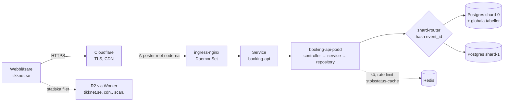
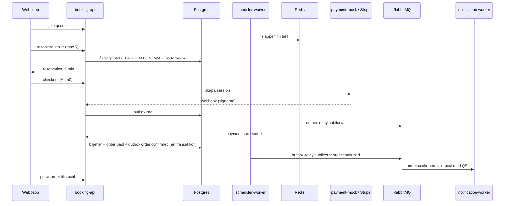
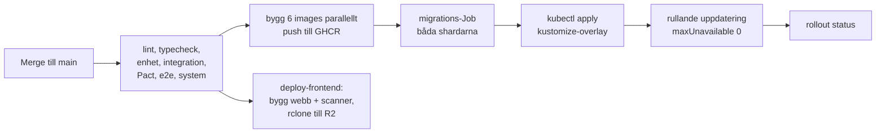
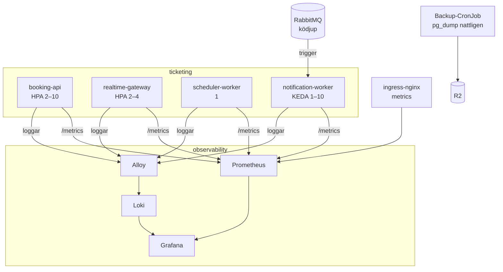

# Arkitektur

Översikt över hur systemet hänger ihop. Detaljerna och motiveringarna finns i
[plan.md](./plan.md), [forsvar.md](./forsvar.md) och ADR:erna i [adr/](./adr/). Diagrammen är
Mermaid-block som GitHub ritar upp.

## Från webbläsare till databas

En request går genom Cloudflare, direkt till en nods ingress-nginx (DNS round-robin mellan
noderna, ingen extern lastbalanserare, [ADR-0007](./adr/0007-dns-round-robin-without-lb.md)) och
vidare till en `booking-api`-podd. ingress-nginx och Servicen lastbalanserar över minst två poddar. Routinglagret hashar `event_id` och väljer shard
([ADR-0008](./adr/0008-sharding-per-event.md)). Postgres är sanningen: Redis avgör aldrig om en stol
får reserveras.

Statiska filer (webbappen, scannern, eventbilder, loggor) ligger i en R2-bucket och serveras av
Cloudflare Workers med en vitlista över prefixen, eftersom samma bucket även håller databas-backuperna.

## Köp: från väntrum till biljett

Kön och reservationen är anonyma (kötoken); inloggning krävs först vid betalning. Efter betalningen går
allt asynkront via transaktionell outbox, så en krasch mellan databasen och RabbitMQ aldrig tappar en
händelse.

Realtid: `realtime-gateway` håller WebSocket-anslutningar och prenumererar på Redis `ws:*`
(köposition, "din stol togs"). `scheduler-worker` är exakt en podd (`Recreate`) och äger insläpp,
frisläpp av utgångna reservationer och outbox-relayen.

## Från merge till produktion

En merge till `main` startar hela kedjan. Migrations körs som ett eget Job med advisory lock mot båda
shardarna, före koden, och måste därför alltid vara framåtkompatibla. Pipelinen avbryts om något steg
misslyckas.

Zero-downtime kräver fyra saker samtidigt: `readinessProbe`, `maxUnavailable: 0`, `preStop` med
`terminationGracePeriodSeconds`, och graceful shutdown i appen. Beviset ligger i
[evidence/zero-downtime.md](./evidence/zero-downtime.md): 0 misslyckade av 22 978 requests under två
rolloutar.

## Observability, skalning och drift

- Autoskalning: HPA på CPU för `booking-api` (mål 70 %, min 2, max 10), på minne för
  `realtime-gateway`, KEDA på ködjup för `notification-worker`.
- Mätning: RED-mått per tjänst, affärsmått (aktiva reservationer, insläppstakt, sålda biljetter) och
  ingress-mått. Dashboarden "Autoscaling & lasttest" visar repliker, last och zero-downtime-raden.
- Backup och återställning: nattlig `pg_dump` av båda shardarna till R2. RPO upp till 24 h; RTO mätt till
  cirka 3 s för hämtning och restore (plus några minuter manuellt arbete) i återställningsövningen (se [runbook.md](./runbook.md)).
- Produktanalys: PostHog EU via `/ingest`-proxyn ([ADR-0009](./adr/0009-posthog-eu-reverse-proxy.md)).
- Kontraktstester: Pact utan broker ([ADR-0011](./adr/0011-pact-without-broker.md)).

## Biljettscanner

Personal loggar in på `scan.tikknet.se` (Auth0, rollen `staff`), väljer event och grind och läser QR-koder
med mobilens kamera ([ADR-0010](./adr/0010-scanner-as-web-app.md)). Varje kod går till `POST /scans`, som
slår upp biljetten på `tickets.qr_token` inom eventets shard och registrerar skanningen i `ticket_scans`.
Det unika indexet på `(event_id, ticket_id)` gör att två samtidiga skanningar av samma biljett ger exakt
en `ok`.
