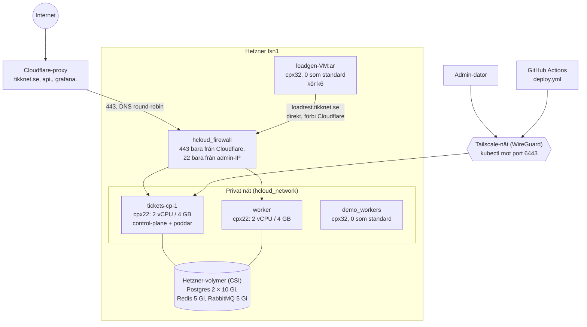
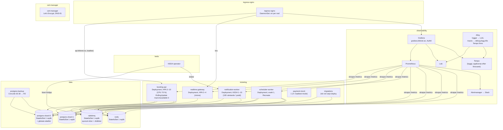

# Klustret

Hur Kubernetes-klustret ser ut: vilka maskiner som finns, vilka namnrymder, och vad som körs var. Hur
delarna pratar med varandra står i [architecture.md](./architecture.md). Motiveringarna finns i
[ADR-0006](./adr/0006-k3s-on-hetzner.md) (k3s på Hetzner), [ADR-0007](./adr/0007-dns-round-robin-without-lb.md)
(ingen lastbalanserare) och [ADR-0001](./adr/0001-tailscale-cluster-access.md) (Tailscale).

## Maskiner och nätverk

Terraform (`infra/terraform`) skapar servrarna, nätverket, brandväggen och Helm-releaserna. k3s
installeras med cloud-init. Appens manifest ägs inte av Terraform utan deployas av GitHub Actions med
Kustomize.

## Namnrymder och poddar

## Sammanfattning

| Del | Typ | Antal | Varför |
|---|---|---|---|
| booking-api | Deployment + HPA | 2–10 | Stateless, skalar på CPU, minst 2 för deploy utan nertid |
| realtime-gateway | Deployment + HPA | 2–4 | Långlivade anslutningar, skalar på minne |
| scheduler-worker | Deployment, `Recreate` | 1 | Jobben får aldrig köras dubbelt |
| notification-worker | Deployment + KEDA | 1–10 | CPU säger inget om en kö, ködjupet gör det |
| payment-mock | Deployment | 1 | Fejkad Stripe för lasttest |
| Postgres × 2, Redis, RabbitMQ | StatefulSet + volym | 1 vardera | Data överlever omstart. En replik = känd enskild felpunkt |
| migrations | Job | per deploy | Körs före koden, advisory lock |
| postgres-backup | CronJob | varje natt | `pg_dump` till R2, RPO upp till 24 h |
| ingress-nginx | DaemonSet | en per nod | DNS pekar på alla noder, ingen lastbalanserare |
| PodDisruptionBudgets | | | Hindrar att alla repliker tas ner samtidigt |
