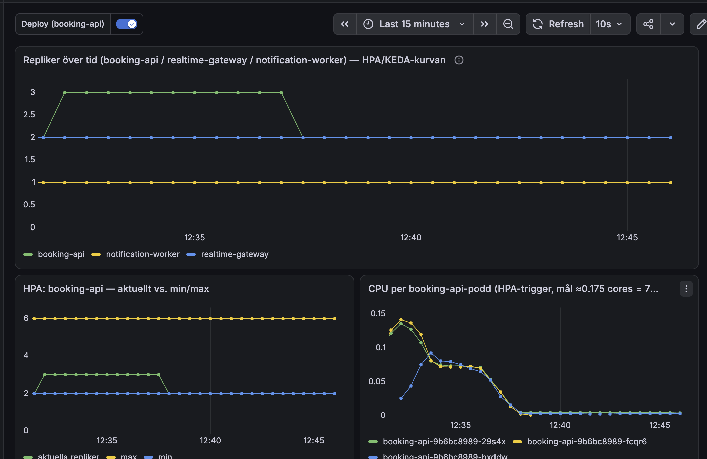
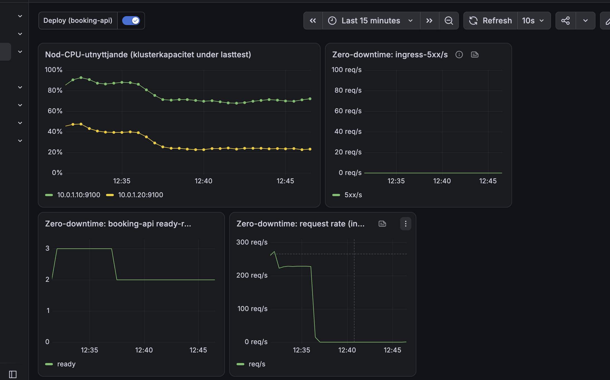

# Bevis: normal-sale 5 november 2026

Körningen efter åtgärderna i `docs/loadtest-cpu-plan.md` ("Körning 5 november: databaspoolen tog
slut"). Samma scenario som körningen före, som gav tusentals 500.

## Körning

| Fält | Värde |
|---|---|
| Tid | 5 november 2026, ca 12:22–12:37 svensk tid |
| Profil | `tests/load/normal-sale.js`: 56 bokningsförsök/s i 15 min, delat på två lastgeneratorer (`--execution-segment`) |
| Väg | Genom Cloudflare (`https://api.tikknet.se`), som riktiga besökare |
| Event | `d401abe5-2b8b-494e-81ce-6d8bc388d18c`, 5 000 platser, nollställt med `reset-sale` före |
| Läge | `loadtest-mode on` (insläpp 3600/min, payment-mock 4 repliker) |

## Resultat från k6 (båda maskinerna)

| Mått | Före åtgärderna | Efter |
|---|---|---|
| Checks | 95,6 % | **100 %** (104 579 av 104 579) |
| Bokningsförsök | 48 746 (+ 1 654 tappade) | **50 401**, 0 tappade |
| Svarstid median / p95 / p99 | 45 ms / 4,96 s / 10,4 s | **23 ms / 130 ms / 350 ms** |
| 500-svar från booking-api | tusentals | **0** |
| `http_req_failed` | 2,8 % | 0,68 %, bara 409 "platsen är redan tagen" (förväntat svar) |

## Resultat från databasen (`normal-sale-2026-11-05-report.json`)

- 995 genomförda köp, 4 975 sålda biljetter, under taket på 5 000.
- Inga dubbelsålda biljettnummer (`duplicateTicketNumbers: []`).
- Inga nya meddelanden i dödköerna.

## Grafana

- Ingress-5xx ligger på 0 under hela körningen.
- booking-api skalade från 2 till 3 poddar. CPU per podd låg under HPA-målet, så mer behövdes inte.
- Kontrollplanets nod låg som mest på ca 90 % CPU i början, den andra noden under 50 %.
