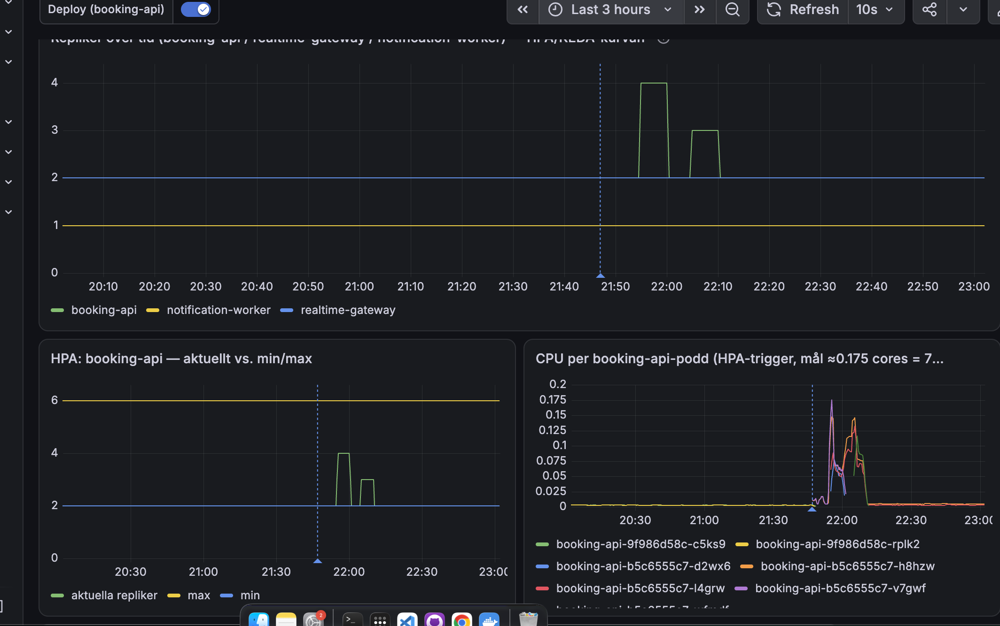
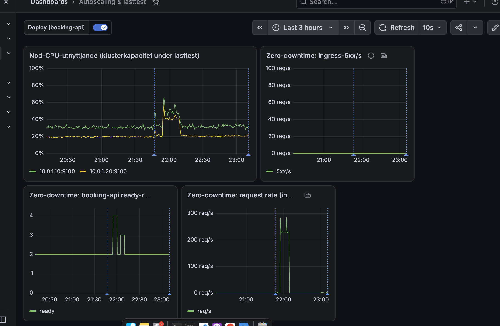

# Bevis: normal-sale 7 november 2026

Omkörning inför inlämningen, efter att `spiketest-fix` (PR #28, kompakt stolsstatus) mergats och
driftsatts. Samma scenario och samma event som [körningen 5 november](./normal-sale-2026-11-05.md).

## Körning

| Fält | Värde |
|---|---|
| Tid | 7 november 2026, ca 21:52–22:07 svensk tid |
| Profil | `tests/load/normal-sale.js`: 56 bokningsförsök/s i 15 min, delat på två lastgeneratorer (`--execution-segment`) |
| Lastskript | `tests/load` från `de993c6` (utan omförsök vid 503), samma checkar som 5 november |
| Väg | Genom Cloudflare (`https://api.tikknet.se`), som riktiga besökare |
| Event | `d401abe5-2b8b-494e-81ce-6d8bc388d18c`, 5 000 platser, nollställt med `reset-sale` före |
| Läge | `loadtest-mode on` (insläpp 3600/min, payment-mock 4 repliker), smoke 100 % och betalda ordrar före |

## Resultat från k6 (båda maskinerna)

| Mått | 5 november | 7 november |
|---|---|---|
| Checks | 100 % | **100 %** (104 917 av 104 917) |
| Bokningsförsök | 50 401, 0 tappade | **50 401** (25 201 + 25 200), 0 tappade, 0 avbrutna |
| Svarstid median / p95 / p99 | 23 ms / 130 ms / 350 ms | **17 ms / 52 ms / 119 ms** (sämsta maskinen) |
| `http_req_failed` | 0,68 % | **0,61 % / 0,59 %**, inga 5xx (ingress-5xx 0, se Grafana). k6 skiljer inte på 4xx-koder; reservationscheckarna (201 eller 409) gick igenom till 100 % |
| Mottagen data per maskin | — | 17 GB (ca 18 MB/s) |

Hela k6-summaryn per maskin: [`normal-sale-2026-11-07-k6-1.json`](normal-sale-2026-11-07-k6-1.json),
[`-k6-2.json`](normal-sale-2026-11-07-k6-2.json).

Enstaka anrop tog mycket lång tid (max 52 s respektive 36 s), men p99 ligger på ca 120 ms.

## Resultat från databasen (`normal-sale-2026-11-07-report-1.json`, `-report-2.json`)

- 992 genomförda köp, 4 960 sålda biljetter, under taket på 5 000.
- Inga dubbelsålda biljettnummer (`duplicateTicketNumbers: []`).
- `oversellPreventedDuringRun`: 0.
- Inga nya meddelanden i dödköerna. `booking-api.payment-succeeded.dead` låg på 4 under hela
  intervallet 20:10–23:10, alltså från före körningen (panelen "Döda meddelanden (dödköer)" i
  "Infrastructure per shard"); `notification-worker.order-events.dead` på 0.

Rapporten läser en k6-fil åt gången, därför två filer. Databasdelen är densamma i båda.

## Grafana

- Ingress-5xx ligger på 0 under hela körningen.
- booking-api skalade 2 → 4 → 2 → 3 → 2. CPU per podd nådde HPA-målet (ca 0,175 kärnor) bara i en
  kort topp i början.
- Noderna låg som mest på ca 65 % respektive 45 % CPU (5 november: ca 90 % på kontrollplanets nod).
- Den streckade linjen vid ca 21:47 är omstarten från `loadtest-mode on`, inte en del av körningen.
