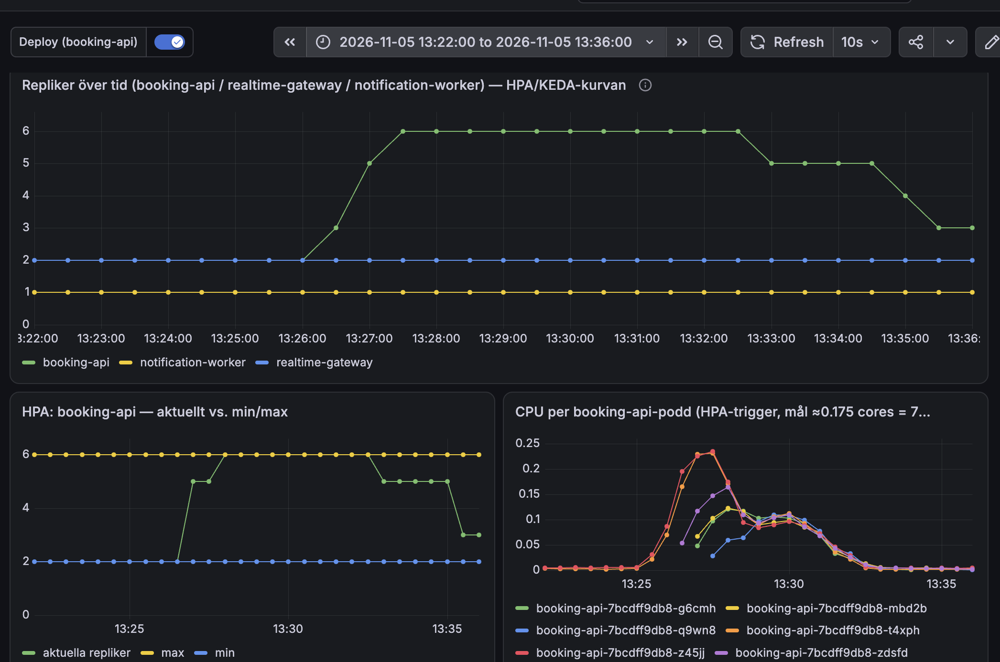
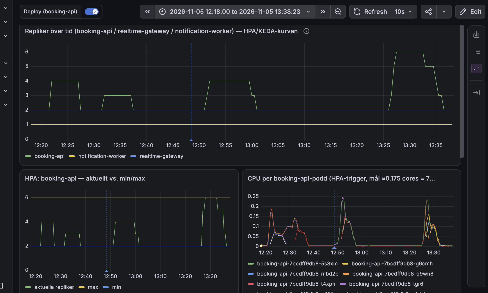

# Bevis: spike-sale 5 november 2026

Körningen efter åtgärderna i `docs/loadtest-cpu-plan.md` ("Körning 5 november"), både databaspoolen och
Alloy-bytet som tog bort loggtrafiken från kontrollplanet.

## Körning

| Fält | Värde |
|---|---|
| Tid | 5 november 2026, ca 13:25–13:32 svensk tid |
| Profil | `tests/load/spike-sale.js`: ca 50 000 bokningsförsök över 6,5 min i toppar upp till ca 337/s, delat på två lastgeneratorer |
| Väg | Genom Cloudflare (`https://api.tikknet.se`) |
| Event | `d401abe5-2b8b-494e-81ce-6d8bc388d18c`, 5 000 platser, nollställt med `reset-sale` före |
| Läge | `loadtest-mode on 24000` (insläpp 24 000/min, alltså i praktiken utan broms) |

## Resultat från k6 (båda maskinerna)

| Mått | Värde |
|---|---|
| Checks | **99,98 %** (89 452 av 89 466) |
| Reservationer och betalningar | 0 misslyckade |
| Svarstid median | ca 98 ms |
| Svarstid p95 / p99 | 6,2–7,6 s / 14–19 s |
| Tappade iterationer | 4 247 (ca 8 %) |

## Resultat från databasen (`spike-sale-2026-11-05-report.json`)

- 912 genomförda köp, 4 560 sålda biljetter, under taket på 5 000.
- Inga dubbelsålda biljettnummer (`duplicateTicketNumbers: []`).
- Platserna som inte såldes hölls av köp som inte blev betalda. payment-mock låter med flit ca 5 % av
  betalningarna misslyckas, och en hållen plats släpps först efter ca 10 minuter, längre än testet.

## Autoskalning

booking-api skalade från 2 till 6 poddar (HPA-taket) på ca 2 minuter när toppen kom, och ner igen efteråt.
Hela eftermiddagens körningar:

## Känd begränsning

I toppen låg kontrollplanets nod (`tickets-cp-1`, 2 kärnor) på ca 88 % CPU, mest ingress-nginx (ca 0,85
kärnor). Det och lastgeneratorernas nätverk (ca 240 MB/s per maskin, mest stolsstatusen på 790 KB som
hämtas varannan sekund) förklarar den långa svarstiden i p95/p99. Det som ska vara korrekt (inga
dubbelsålda platser, inga misslyckade reservationer eller betalningar) höll hela vägen.
