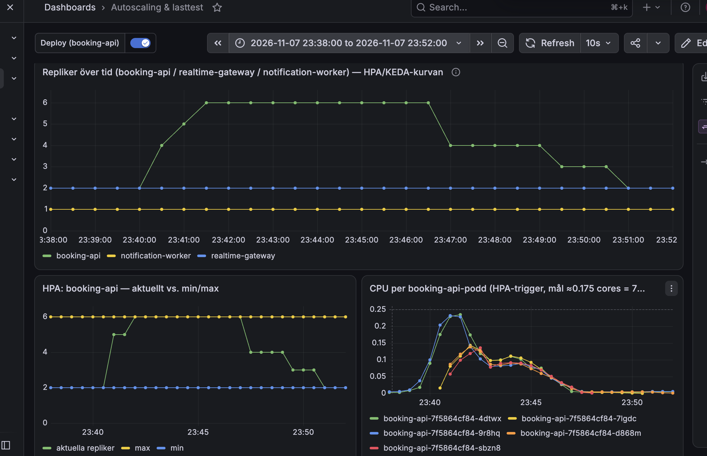
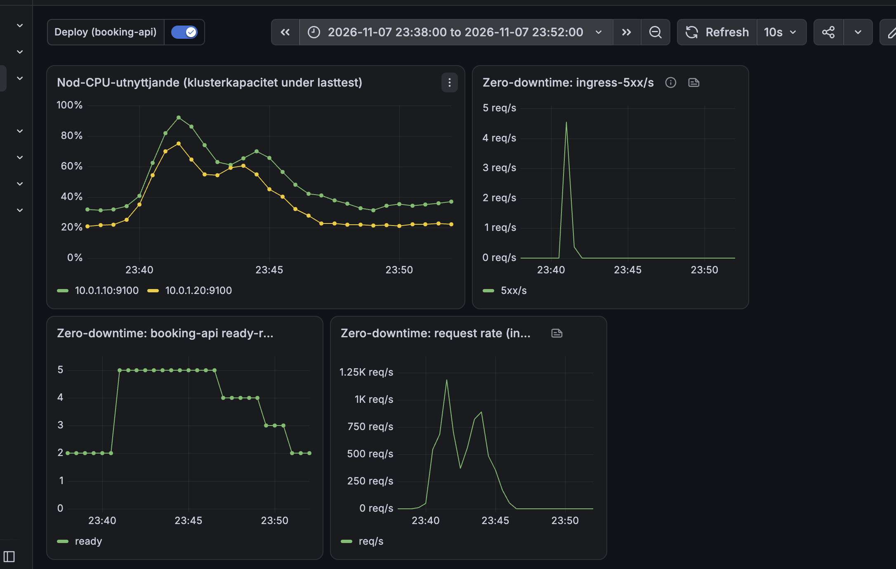
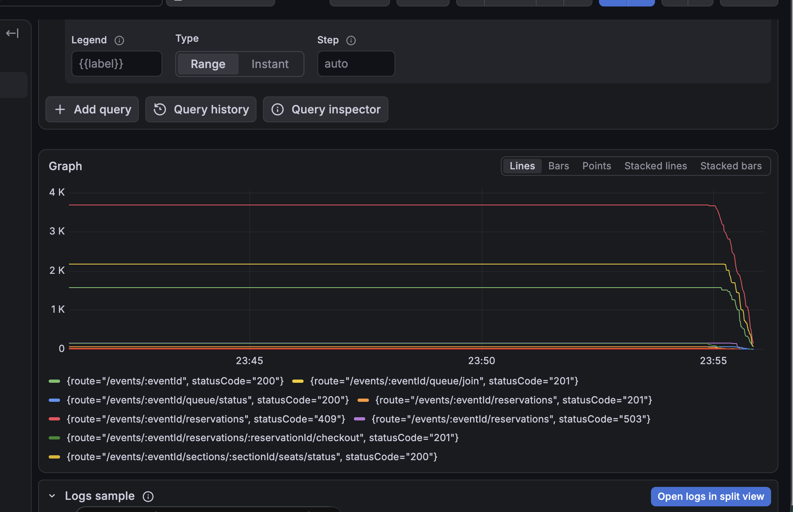
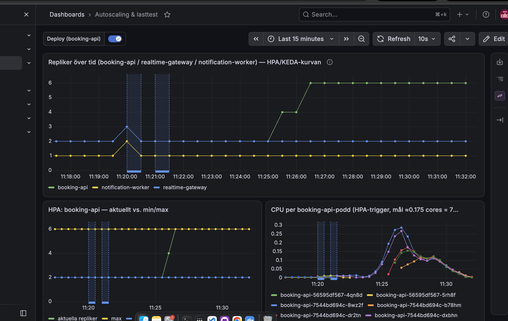
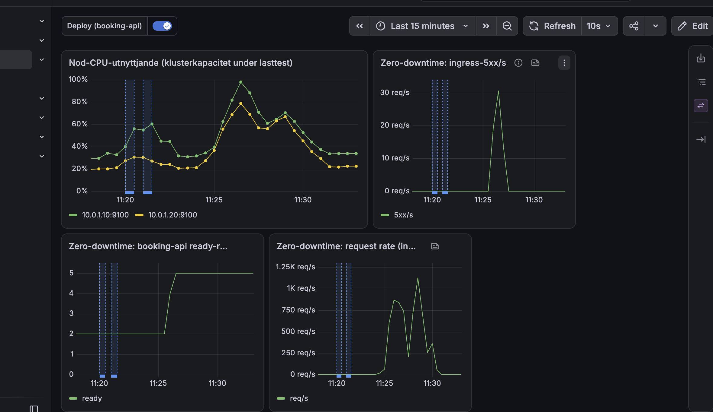

# Bevis: spike-sale 7 november 2026

Omkörning inför inlämningen, efter att `spiketest-fix` (PR #28) mergats och driftsatts. Samma scenario och
samma event som [körningen 5 november](./spike-sale-2026-11-05.md). Det här är spikebeviset för
inlämningen; försöket 8 november längst ner gav sämre resultat och koden från det är återställd.

## Körning

| Fält | Värde |
|---|---|
| Tid | 7 november 2026, ca 23:40–23:47 svensk tid |
| Profil | `tests/load/spike-sale.js`: ca 50 000 bokningsförsök över 6 min i toppar upp till ca 337/s, delat på två lastgeneratorer (`--execution-segment`) |
| Kod och lastskript | `de993c6` (utan omförsök vid 503) |
| Väg | Genom Cloudflare (`https://api.tikknet.se`), som riktiga besökare |
| Event | `d401abe5-2b8b-494e-81ce-6d8bc388d18c`, 5 000 platser, nollställt med `reset-sale` före |
| Läge | `loadtest-mode on 24000` (insläpp 24 000/min, alltså i praktiken utan broms) |
| Lastgeneratorer | två Hetzner cpx52 (`tickets-loadgen-1`, `-2`) |

## Resultat från k6

| Mått | Maskin 1 | Maskin 2 |
|---|---|---|
| Anrop | 310 268 (802/s) | 311 836 (807/s) |
| `http_req_failed` | 1,45 % (4 525) | 0,12 % (385) |
| Checks | 99,71 % (52 950 av 53 103) | 99,99 % (48 519 av 48 520) |
| Reservationscheck (201 eller 409) | 97 % (153 fel) | 99 % (1 fel) |
| `queue/join`, `checkout`, WebSocket (101) | 100 % | 100 % |
| Svarstid median / p95 / p99 | 16 ms / 1,2 s / 5,5 s | 15 ms / 156 ms / 1,4 s |
| Iterationer / tappade | 24 169 / 877 | 24 785 / 261 |
| Mottagen data | 16 GB (41 MB/s) | 16 GB (42 MB/s) |

Hela k6-summaryn per maskin: [`spike-sale-2026-11-07-k6-1.json`](spike-sale-2026-11-07-k6-1.json),
[`-k6-2.json`](spike-sale-2026-11-07-k6-2.json).

Totalt ca 622 000 anrop och 48 954 genomförda bokningsförsök (av ca 50 000; 1 138 tappades för att k6
inte hann starta fler VU:er i toppen). Inga avbrutna iterationer.

## Resultat från databasen (`spike-sale-2026-11-07-report-1.json`, `-report-2.json`)

- 919 genomförda köp, 4 595 sålda biljetter, under taket på 5 000 (`soldWithinInventory: true`).
- Inga dubbelsålda biljettnummer (`duplicateTicketNumbers: []`).
- `oversellPreventedDuringRun`: 0.
- Platserna som inte såldes hölls av köp som inte blev betalda (payment-mock låter med flit ca 5 % av
  betalningarna misslyckas, och ett håll släpps först efter ca 10 minuter, längre än testet).

Rapporten läser en k6-fil åt gången, därför två filer. Databasdelen är densamma i båda.

## Grafana

- booking-api skalade 2 → 6 (HPA-taket) mellan ca 23:40 och 23:41:30, låg kvar på 6 under lasten och
  skalade ner 6 → 4 → 3 → 2 efteråt. Autoskalning upp och ner.
- CPU per podd gick över HPA-målet (ca 0,175 kärnor) bara i den första toppen, upp till ca 0,23.
- Ingress-5xx syns som en enda kort topp (ca 4,5/s) runt 23:41, när toppen kom innan de nya poddarna var
  beredda. Sedan 0 resten av körningen.
- Request rate nådde ca 1 150 req/s i första toppen och ca 900 req/s i den andra.
- Noderna låg som mest på ca 92 % respektive 75 % CPU, i första toppen.

## Felen, från servern

Loggarna i Grafana (Loki) för körningen, per felkod:

| Fel | Antal | Betyder |
|---|---|---|
| `SEAT_UNAVAILABLE` (409) | 4 756 | Stolen hann tas av någon annan. Korrekt svar, inte ett fel |
| `database connection pool exhausted` (503) | 154 | Se "Känd begränsning" |
| `non-operational domain error` (500) | 8 | Webhooks för betalningar som `reset-sale` redan raderat ("No payment row found"), loggade kring 23:40, före lasten |
| `slow request` | 7 900 | Varning för anrop över tröskeln, inte fel |

Grafen visar de ackumulerade anropen per route och statuskod under körningen: ca 3 700 reservationer med
409, ca 150 med 503, och resten lyckade.

## Känd begränsning

De 503-svar som finns kommer från första toppen. booking-api startar med 2 poddar och HPA behöver ca 1,5 min
för att skala upp; under tiden tar databasanslutningarna slut (`DB_POOL_MAX=6` per podd, budget ca 84 av 100
per shard) och servern svarar 503 med `Retry-After: 1` efter 5 s väntan på en anslutning. Det ger den
långa svarstiden i p95/p99 på maskin 1. Det som ska vara korrekt (ingen överförsäljning, inga dubbletter)
höll hela vägen.

Planerade åtgärder: PgBouncer framför Postgres, så att fler poddar kan dela färre anslutningar, och ett tak
för omförsök i klienten.

## Försöket 8 november (förkastat)

Inför inlämningen försökte vi minska felen, bland annat med omförsök vid 503 och ändrad reservpollning i
väntrummet. Spiken kördes om på förmiddagen 8 november med den koden och blev sämre:

| Mått | 7 november | 8 november |
|---|---|---|
| `http_req_failed` | 1,45 % / 0,12 % | 1,99 % / 2,03 % |
| Svarstid p95 / p99 | 1,2 s / 5,5 s (sämsta maskinen) | 4,2 s / 10,6 s |
| Tappade iterationer | 1 138 | 4 496 |

Omförsöken ökade trycket på databaspoolen i stället för att minska det. Koden återställdes till
`de993c6` (grenen `revert-spike-code`), och körningen 7 november är beviset. Grafana från försöket:

