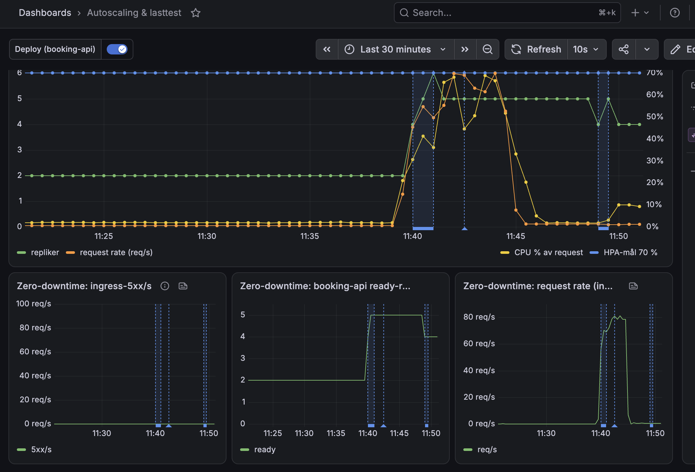
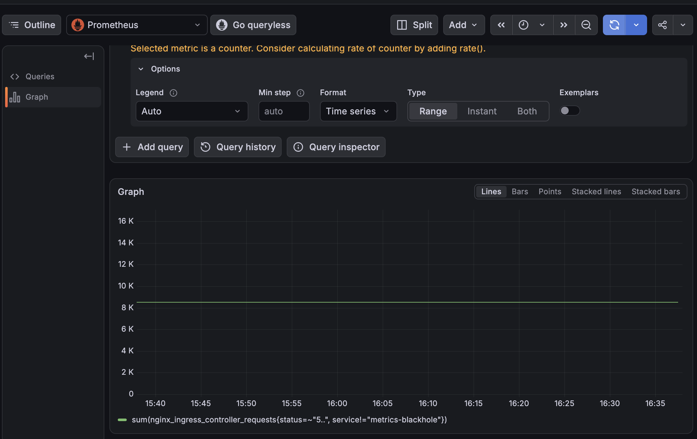

# Bevis: deploy utan nertid

Mål (docs/plan.md 7.3): `http_req_failed` = 0 medan `booking-api` rullas ut under last.
Körordning: `docs/runbook.md` "Bevis: deploy utan nertid". Motivering till att deployen är
`kubectl rollout restart` och inte en merge: `docs/forsvar.md`.

## Körning

| Fält | Värde |
|---|---|
| Datum och tid | 30 oktober 2026, cirka 10:38–10:48 UTC (11:38–11:48 svensk tid) |
| Profil | `tests/load/deploy-under-load.js`: 10 iterationer/s i 5 min (3 000 bokningsförsök, 1 stol per försök) |
| Event | `d401abe5-2b8b-494e-81ce-6d8bc388d18c` (lasttest-eventet, nollställt med `reset-sale` före körningen) |
| Deploy | `kubectl rollout restart deployment/booking-api -n ticketing`, två gånger (efter ca 1 och ca 3 min). Båda rolloutarna avslutades med `successfully rolled out`, 5 repliker (HPA hade skalat upp från 2) |
| Loadtest-läge | `loadtest-mode on` (insläpp 3600/min, payment-mock 4 repliker) |
| Last | k6 från en loadgen-VM (`2.31.97.17`) mot `https://loadtest.tikknet.se` |

## Resultat från klienten (k6)

| Mått | Krav | Utfall |
|---|---|---|
| `http_req_failed` | 0,00 % | **0,00 %** (0 av 22 978 requests) |
| `dropped_iterations` | 0 | **0** |
| `checks` | 100 % | **100 %** (8 993 av 8 993) |
| Thresholds | alla gröna, k6 avslutar med 0 | **Alla gröna** (`checks`, `completed_bookings`, `dropped_iterations`, `http_req_failed`) |
| Totalt antal requests | — | 22 978 (ca 76 req/s) |
| Genomförda bokningar | > 0 | 2 993 av 3 000 försök (resten fick 409, "stolen redan tagen", som är ett korrekt svar) |

Svarstider: avg 38,8 ms, median 10,8 ms, p(95) 139 ms, p(99) 571 ms, max 1,93 s.

Utdrag ur k6-summaryn (`zero-downtime-summary.json`):

```json
{
  "http_req_failed":   { "passes": 0, "fails": 22978, "value": 0 },
  "dropped_iterations": { "count": 0 },
  "checks":            { "passes": 8993, "fails": 0, "value": 1 },
  "completed_bookings": { "count": 2993 },
  "http_reqs":         { "count": 22978, "rate": 76.08 },
  "iterations":        { "count": 3000, "rate": 9.93 }
}
```

## Resultat från servern (ingress-nginx)

Fråga i Grafana Explore: `sum(nginx_ingress_controller_requests{status=~"5..", service!="metrics-blackhole"})`.
Panelen "ingress-5xx/s" ser inte de första 5xx-svaren (en ny serie startar på 1 och `rate()`
räknar inte det första hoppet), därför läses råräknaren före och efter. Kontrollfrågan
`sum(nginx_ingress_controller_requests)` gav data (ca 570 totalt före körningen), så ingress-måtten skrapas
och "No data" betyder att inga 5xx någonsin har registrerats.

| | Värde |
|---|---|
| Före körningen | 0 ("No data", cirka 11:35 svensk tid) |
| Efter körningen | 0 ("No data") |
| Skillnad (krav: 0) | **0** |

## Grafana

Skärmdump av "Autoscaling & lasttest" → zero-downtime-raden över körningens tidsintervall:



Den visar att ingress-5xx/s ligger platt på 0 under hela körningen, att antalet beredda
`booking-api`-poddar går från 2 till 5 under lasten, att request rate når cirka 80 req/s, och att
deploy-annotationerna syns kring 11:40 (svensk tid).

## Slutsats

Två rullande deployer av `booking-api` (`maxUnavailable: 0`, probes, preStop) under 10 bokningsförsök i
sekunden gav **noll misslyckade requests** på klienten och **noll 5xx** på ingress-nginx. Kravet i 7.3
är uppfyllt. Beviset kördes mot koden som fanns i produktion efter merge av `feature/fas7-ui`
(inklusive direktinsläpp i väntrummet).

Förbehåll: k6 mäter HTTP-anropen. En del simulerade betalningar i payment-mock misslyckas medvetet
(5 % kaos), vilket påverkar orderstatusen men inte `http_req_failed`.

## Omkörning 8 november 2026

Samma körordning och profil som ovan, inför inlämningen. Koden var den som spiken 7 november (23:40)
kördes mot (`de993c6`, återställd via grenen `revert-spike-code`).

| Fält | Värde |
|---|---|
| Datum och tid | 8 november 2026, cirka 16:30–16:36 svensk tid |
| Profil | `tests/load/deploy-under-load.js`: 10 iterationer/s i 5 min |
| Event | lasttest-eventet, nollställt med `reset-sale` före körningen |
| Deploy | `kubectl rollout restart deployment/booking-api -n ticketing` två gånger (efter ca 1 och ca 3 min) |
| Loadtest-läge | `loadtest-mode on` |
| Last | k6 från loadgen-VM 1 (`167.233.220.60`) mot `https://loadtest.tikknet.se` |

| Mått | Krav | Utfall |
|---|---|---|
| `http_req_failed` | 0,00 % | **0,00 %** (0 av 43 401 requests) |
| `dropped_iterations` | 0 | **0** |
| `checks` | 100 % | **100 %** (10 986 av 10 986) |
| Thresholds | alla gröna | **Alla gröna** |
| Genomförda bokningar | > 0 | 2 988 av 3 001 försök (resten 409, "stolen redan tagen") |
| Svarstider | — | avg 19,3 ms, median 5,1 ms, p(95) 65 ms, p(99) 194 ms, max 2,27 s |
| WebSocket | — | 1 996 sessioner, alla uppgraderade (101) |

Hela k6-summaryn: [`zero-downtime-2026-11-08.json`](zero-downtime-2026-11-08.json).

5xx-räknaren i ingress-nginx (samma fråga som ovan, typ Instant). Värdet är summerat från tidigare
spike-körningar; det som avgör är skillnaden.

| | Värde |
|---|---|
| Före körningen (16:29) | 8 521 |
| Efter körningen (16:39) | 8 521 |
| Skillnad (krav: 0) | **0** |



Slutsats: kravet i 7.3 håller fortfarande. Två rullande deployer under last gav noll misslyckade
requests och noll nya 5xx.
